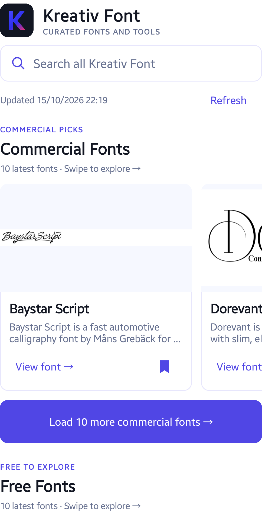
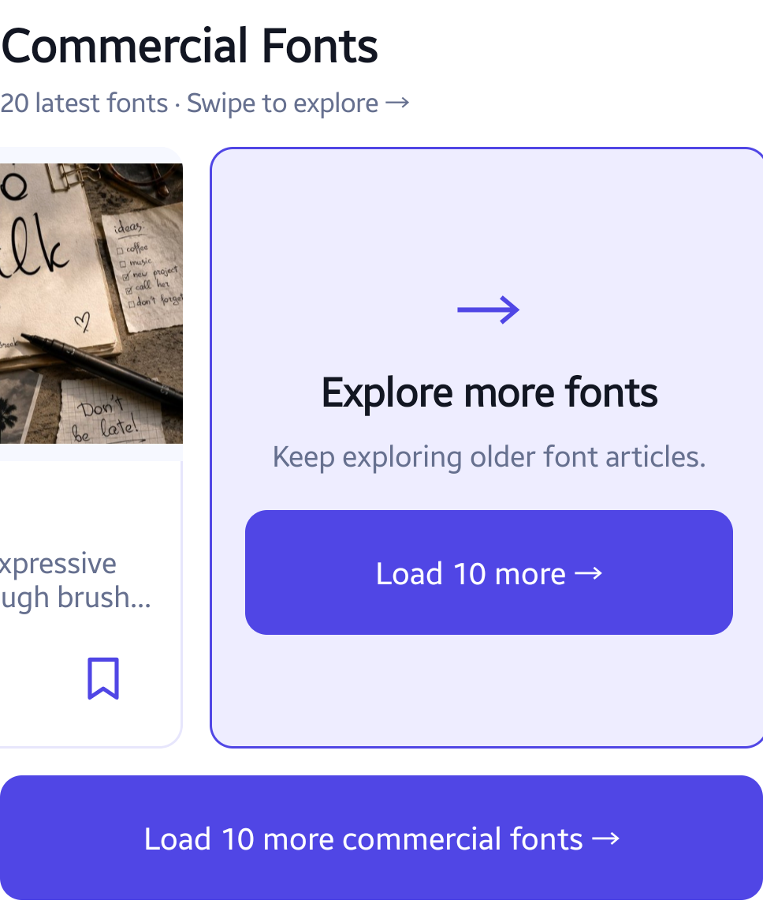
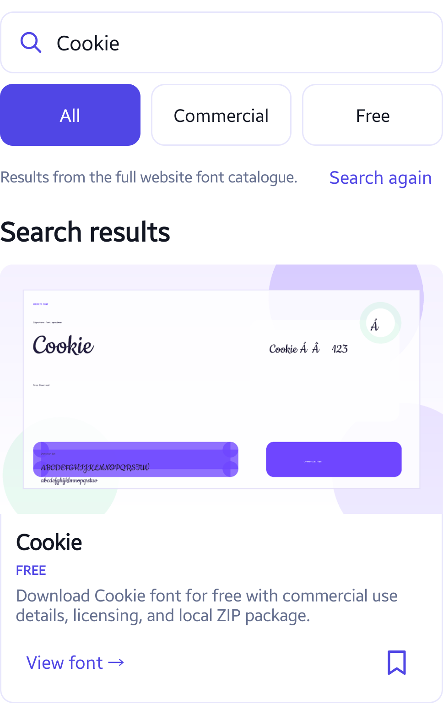
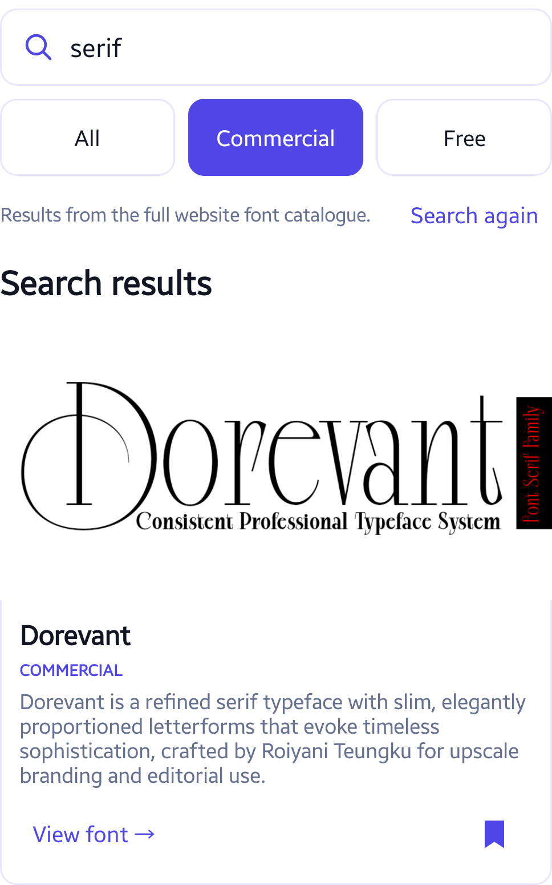
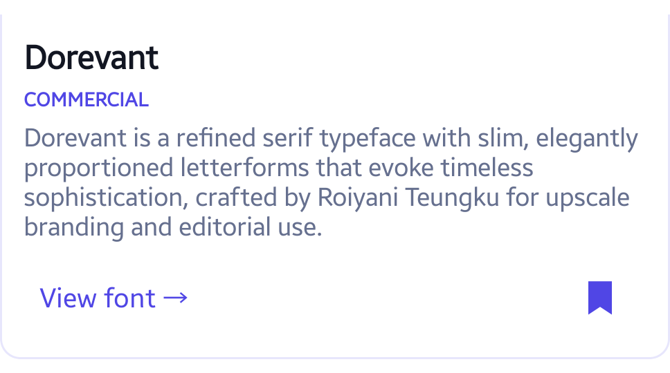

Use Kreativ Font to find typefaces for a design project and keep a shortlist on your Android phone. Browse the website's font articles, search for a name or style, inspect preview artwork and bookmark interesting results.

The app is free, but linked fonts have their own prices and licences. Kreativ Font is not a phone-font installer, text editor or font identifier. It does not change your system font or install fonts into another app.

The screenshots show the released 2.3.0 interface on a Samsung Galaxy A55, captured on 15 October 2026. Article titles, artwork, results and favourite counts are examples from that session, not a promise of today's catalogue. Tap an image to view it at full size. Font artwork belongs to its respective creators.

[Get Kreativ Font on Google Play](https://play.google.com/store/apps/details?id=com.kreativ.fontapp&utm_source=madebykreativ&utm_medium=website&utm_campaign=kreativfont_discovery_202610&utm_content=font_tutorial_intro)

## Browse the latest font articles

Open the **Fonts** tab. **Commercial Fonts** and **Free Fonts** are separate horizontal sections. Swipe a section sideways to explore its cards; scroll vertically to reach the other section.

Each section starts with 10 recent articles. Tap a card's title to read its description. Tap **Refresh** when connected to check for new articles.

*Commercial and free are catalogue categories. Always check the individual font's current licence.*

## Continue beyond the latest ten

Tap **Load 10 more commercial fonts** or **Load 10 more free fonts** below the relevant carousel. The **Explore more fonts** card at the end of a carousel provides another way to load its next batch.

*The two sections load independently. A smaller final batch or an end message means you have reached the available catalogue for that section.*

If a request fails, check the connection and use **Retry loading**. Previously fetched entries can remain available; that does not mean the whole catalogue is stored offline.

## Search the website catalogue

Tap **Search all Kreativ Font** and enter a font name or style. This searches the website catalogue, not only the cards currently loaded on the Fonts tab. The example below uses **Cookie**.

*Catalogue search requires internet. Your search phrase is sent to kreativfont.com and may appear in hosting request logs. Do not enter personal or sensitive details.*

Use **Load 10 more** for another batch of up to 10 unique results. The final batch may be smaller. **Search again** returns to the search controls. Searching your saved favourites is a separate, local operation.

## Narrow the results

Choose **All**, **Commercial** or **Free** above the results. Changing the filter starts the matching result list again. The example uses **serif** with **Commercial** selected.

*A Free result is not a guarantee of unrestricted commercial use. The linked publisher's terms determine permitted uses.*

Tap a preview image to open the website artwork full-screen. Pinch to zoom, drag to pan or double-tap to zoom or reset. You can also use **Zoom in**, **Zoom out** and **Fit**. Use **Close** to return. This enlarges an existing image; it is not a live type tester and does not accept custom text.

## Save a shortlist

Tap the bookmark on a font card to save it. A filled bookmark identifies a saved entry. Open **Favorites** to revisit your saved articles; tap the bookmark again to remove one.

*The picture shows a saved bookmark in search results, not the Favorites screen. Saving an article does not download or license its font files.*

Favourites retain their article description and link after they leave the latest feed. **Search saved favorites** filters them on the device. There is no account or cloud sync: clearing app storage or uninstalling removes the shortlist. Previously loaded text may work offline, while artwork depends on the image cache and can be evicted.

## Open the article and check the licence

Tap **View font** to open the original kreativfont.com article in your browser. Follow the article's current publisher or download links and read the licence for your intended use. The app does not sell, install or deliver commercial font files.

Some website links may be affiliate links. Browser visits use the destination website's own privacy, cookie and affiliate terms. The native app does not run the website's advertising or analytics scripts.

## Understand online and local data

Current catalogue requests and preview images use internet access. Hosting/CDN services receive technical request information; online searches can include your phrase in request URLs. Local favourites search does not send a catalogue query. No account, camera, photo-library, contact or location access is required by the native app.

Read the [Android app privacy section](https://kreativfont.com/blog/terms-of-use-privacy-policy#android-app-privacy). The app interface and website articles are in English.

[Explore Kreativ Font](https://madebykreativ.com/apps/kreativ-font/) or [get it on Google Play](https://play.google.com/store/apps/details?id=com.kreativ.fontapp&utm_source=madebykreativ&utm_medium=website&utm_campaign=kreativfont_discovery_202610&utm_content=font_tutorial_footer).
