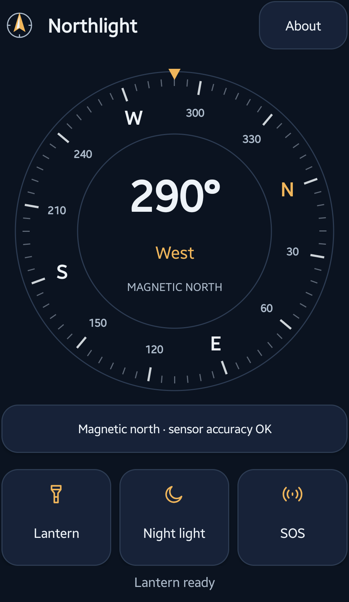
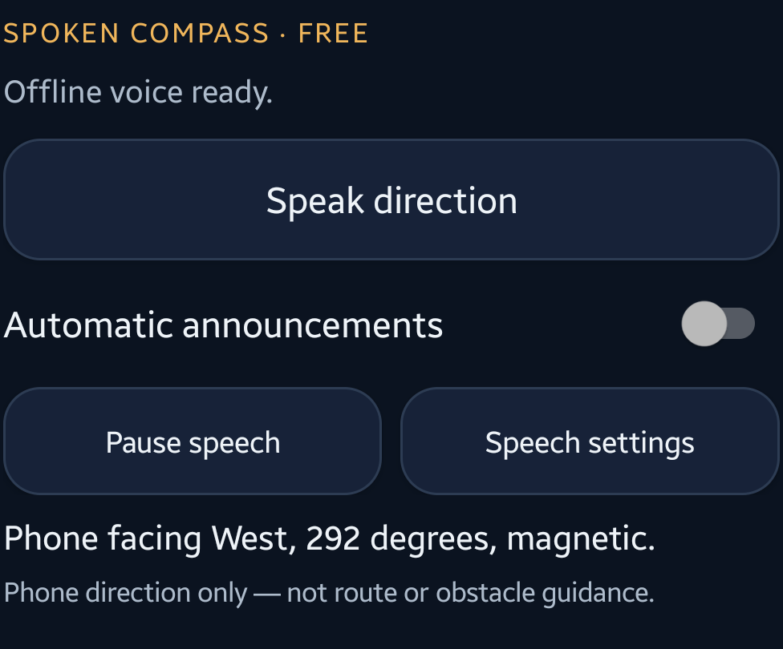
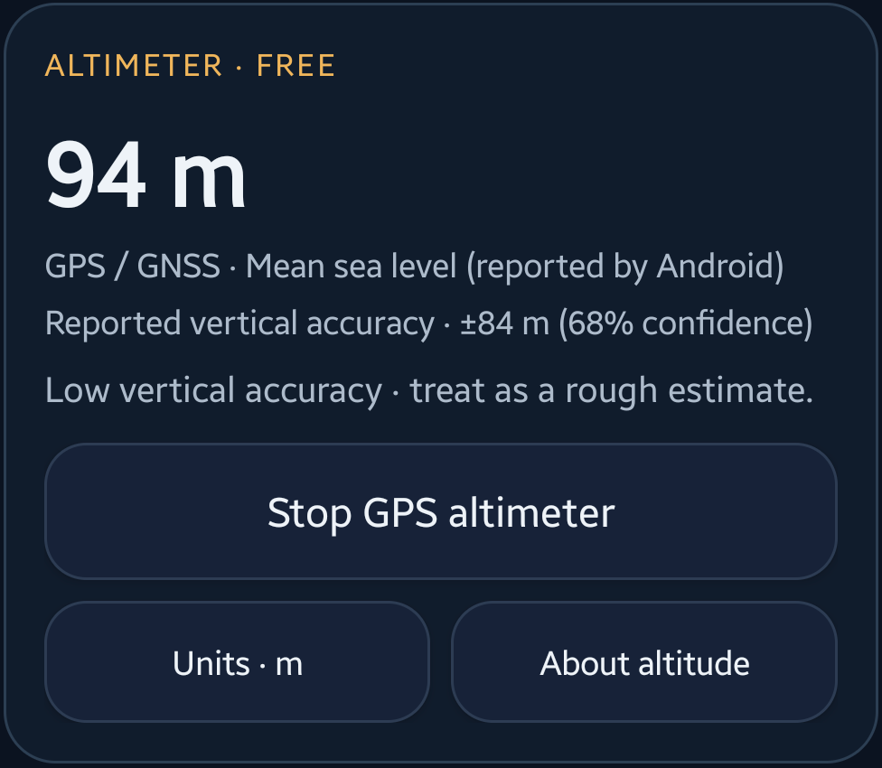
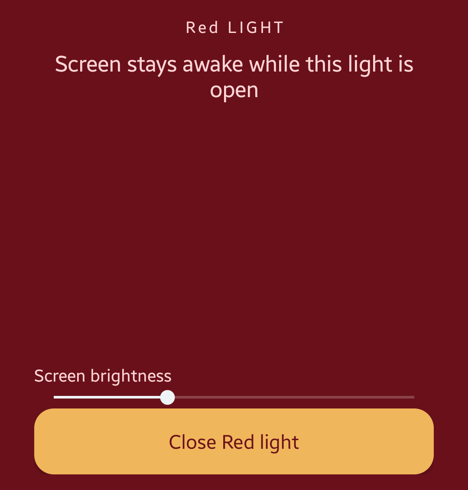

Open Northlight and hold your Android phone flat, with its top edge pointing in the direction you want to check. Read the heading in the compass dial and check the accuracy message beneath it. Northlight shows **magnetic north**, not true north, and does not plan a route.

This guide covers the Google Play edition. The compass, spoken headings, GPS altimeter, lantern, red screen light and SOS signal are free. You do not need Pro for the steps below.

Screenshots show the real Northlight 1.2.0 preview build on a Samsung Galaxy A55. Its app interface matches the released version. The headings and altitude shown are readings from that capture session, not readings for your current location or phone. Tap a screenshot to view it at full size.

[Get Northlight on Google Play](https://play.google.com/store/apps/details?id=com.kreativ.northlight&utm_source=madebykreativ&utm_medium=website&utm_campaign=northlight_offline_202610&utm_content=compass_tutorial_intro)

## Read the magnetic compass

The large number shows the phone's magnetic heading in degrees. The direction word gives a simpler label, such as North or West. The compass depends on the phone's sensors; some phones do not have a usable compass sensor.

Point the top of the phone towards the direction you want to inspect. Move away from metal surfaces, speakers, magnets or a magnetic phone mount before interpreting the reading. A phone case can also cause interference.

Read the accuracy message under the dial. If calibration is needed, tap that message for guidance and move the phone slowly in a figure-eight away from metal or magnets. Calibration feedback is not a guarantee that a reading is precise.

*A real captured heading. Northlight reports the direction the phone points, not the direction a person is walking.*

## Hear a spoken heading

Scroll to **SPOKEN COMPASS · FREE** and tap **Speak direction**. Northlight uses an installed offline voice matching the app language, in English or Romanian. It does not use your microphone or record audio.

If no suitable voice is installed, open **Speech settings** and choose **Manage offline voices**. Android's voice installer may need an internet connection to download voice data. After setup, return to Northlight and try again.

For repeated readings, turn on **Automatic announcements**. The app announces stable heading changes rather than speaking continuously. Speech settings let you adjust the minimum interval and voice speed. Use **Pause speech** when finished. Leaving the app pauses speech; it does not restart automatically when you return.

With a screen reader active, explicitly requested readings are handed to that screen reader and automatic app speech is disabled to avoid overlapping voices. The screen reader uses its own voice and privacy settings.

*Spoken headings describe phone orientation. They are not obstacle warnings, walking directions or safe-crossing instructions. Keep surrounding sounds audible.*

## Check a GPS altitude estimate

The altimeter is optional and off by default. Scroll to **ALTIMETER · FREE** and tap **Start GPS altimeter**. Read the explanation, then allow precise foreground location if you want to use this feature. After granting permission, tap Start again to begin measurement.

Compass, speech and light tools do not need location access. If you allow only approximate location, the altimeter stays off and explains why. You can continue using the other tools.

GPS needs usable satellite reception. An open view of the sky helps, and the first fix can take time. A missing reading is not zero altitude. Continuous GPS uses extra battery.

Read the information beside the number:

- **Reference** identifies what the height is relative to. Android may report mean-sea-level altitude. Otherwise Northlight labels the WGS84 reference, which is not sea level or height above the ground.
- **Reported vertical accuracy** describes the uncertainty supplied by Android for that reference. It is not a guaranteed maximum error.
- **Status** explains low accuracy, missing uncertainty, stale readings or a wait for a usable fix.

*This example shows why the uncertainty matters: 94 m is accompanied by ±84 m at 68 percent confidence and a low-accuracy warning. Do not read it as a precise elevation.*

Tap **Units** to switch between metres and feet; this changes the display, not the measurement. Tap **Stop GPS altimeter** when finished. Leaving the home screen or locking the phone also stops measurement. Returning does not restart it automatically.

Northlight does not save coordinates, routes or an altitude history. The altimeter is not intended for climbing, aviation, rescue or other safety-critical decisions.

## Choose a light tool

The three controls beneath the compass open **Lantern**, **Night light** and **SOS**.

**Lantern** uses the phone's camera LED. Android may ask for camera permission so Northlight can control the flash; the app does not take photos or record video. Brightness adjustment is available only on supported phones. If another app is using the camera flash, the lantern may be unavailable.

**Night light** opens the free red screen light. Adjust **Screen brightness**, then use **Close Red light** when finished. The screen stays awake while the light is open.

*A steady red screen light, not a flashing demonstration.*

**SOS** repeats a flash signal on phones with a usable camera flash and permission. Use **Stop SOS** to end it. This is only a flashing light: it does not make an emergency call, transmit your location or contact a rescue service. Avoid flashing lights near people sensitive to flashes.

The optional Quick Settings lantern tile provides another way to access the torch after camera permission has been granted in the app. Tile placement depends on the phone's Android interface.

## What optional Pro adds

Northlight Pro is a one-time Google Play purchase, not a subscription. It adds up to eight named magnetic bearings stored on the phone, optional spoken phone-turn guidance and alignment vibration, amber and green screen lights, and an adjustable flash strobe.

Saved bearings are directions, not saved places or routes. Voice and vibration cues tell you about phone alignment; they cannot establish that a path is safe or that you have arrived somewhere. Haptic feedback depends on phone hardware and Android settings.

The local Pro price is shown before purchase. Use the same Google Play account to restore ownership. The compass, spoken headings, altimeter and basic light tools remain free.

## What works offline

The compass and light tools work on the phone without a network connection. Speech needs a suitable offline voice already installed. GPS does not require mobile data, but it does need satellite reception. Google Play purchases and ownership checks use the internet, and external website links open your browser when tapped.

Northlight has no account, advertising or analytics. Read the [Northlight privacy policy](https://madebykreativ.com/privacy/northlight/) for details about permissions, local records, speech and optional purchases.

## Before relying on a reading

Check sensor accuracy, read the altitude reference and uncertainty, and distinguish phone orientation from navigation. Keep a separate means of emergency communication. Northlight is a convenient compass and light utility, not safety-critical navigation equipment.

[Explore Northlight](https://madebykreativ.com/apps/northlight/) or [get it on Google Play](https://play.google.com/store/apps/details?id=com.kreativ.northlight&utm_source=madebykreativ&utm_medium=website&utm_campaign=northlight_offline_202610&utm_content=compass_tutorial_footer).
