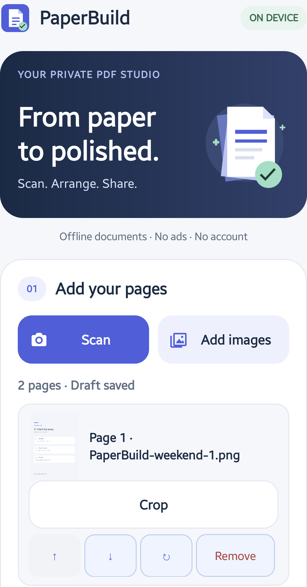
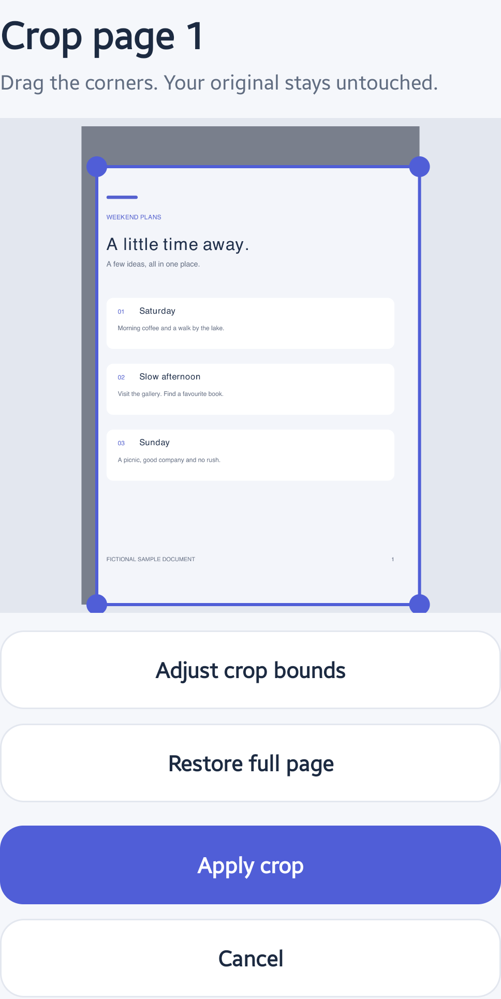
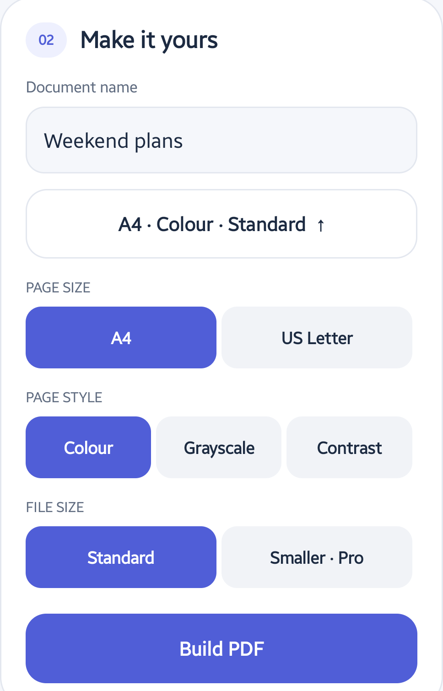
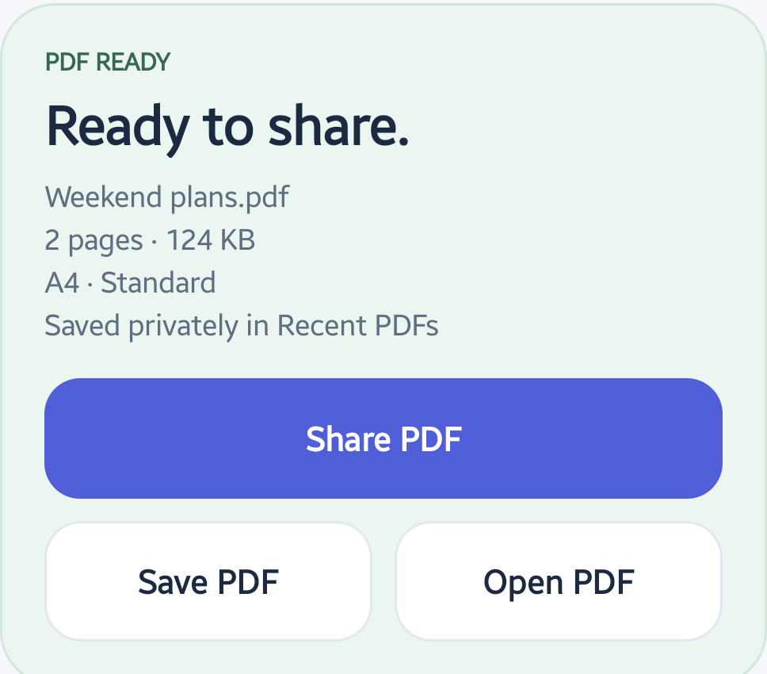
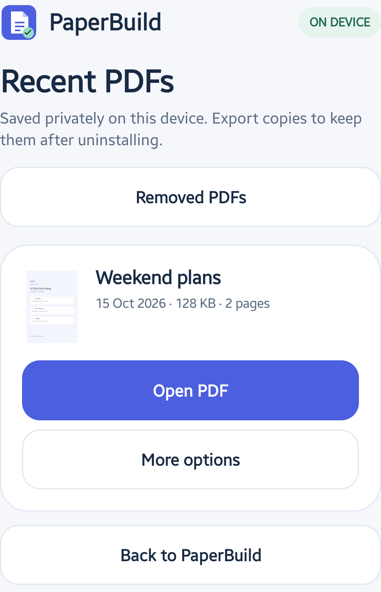

Open PaperBuild, add your page images, check their order and tap **Build PDF** to create one document on your Android phone. You can crop pages and choose a page style before exporting. The free workflow supports up to 10 pages per document and does not need Pro.

The screenshots show PaperBuild 1.1.0 on a Samsung Galaxy A55 using fictional weekend-plan pages. The separate QA build uses the released app interface. Document names, sizes and dates in the pictures are examples. Tap a screenshot to view it at full size.

[Get PaperBuild on Google Play](https://play.google.com/store/apps/details?id=com.kreativ.paperbuild&utm_source=madebykreativ&utm_medium=website&utm_campaign=paperbuild_photos_pdf_202610&utm_content=pdf_tutorial_intro)

## Add the page images

Tap **Add images** to choose one or more images with Android's system picker. PaperBuild does not request broad access to your gallery. A cloud-backed picker may need to download a selected image before the app can use it.

Alternatively, tap **Scan** to open your phone's camera app. Photograph the page and confirm the capture there. PaperBuild uses the resulting image; it does not directly control the camera or automatically detect the page edges.

For a first try, photograph a non-sensitive sample page in good light. Keep the page flat and check that the text is readable and not cut off.

*The sample draft has two fictional pages. Your selected originals are not overwritten.*

## Crop and arrange the pages

Each page card has controls to move the page up or down, rotate it, remove it from the draft or open **Crop**. Check the order before exporting.

In Crop, drag the corners to select the part you want to keep. **Adjust crop bounds** provides percentage controls if you prefer precise entry. Use **Restore full page** to reset the selection, then **Apply crop** to keep it or **Cancel** to leave without applying a new crop.

*Cropping changes the PDF layout, not the source image. It is not a tool for securely redacting confidential content.*

PaperBuild saves the current draft privately on the device. You can resume it after closing the app. **New document** clears that draft and its private page copies, not your original images or completed PDFs.

## Choose PDF settings

Under **Make it yours**, enter a document name and expand the settings button below it. Choose **A4** or **US Letter**. For page style, use **Colour**, **Grayscale** or **Contrast**. These change the exported page appearance; they do not recognise or turn text into editable text.

Keep **Standard** file size for the free workflow. **Smaller · Pro** is an optional paid setting. Review readability when choosing a page treatment or smaller export.

*The example uses A4, Colour and Standard. The Smaller option is explicitly marked Pro.*

## Build and keep a PDF copy

Tap **Build PDF** and wait for **Ready to share**. Read the summary and check the number of pages. Tap **Open PDF** to inspect the result in a PDF viewer before sending it.

Use **Save PDF** to save a copy to **Downloads/PaperBuild**. On Android 8 and 9, saving may require storage permission. Android 10 and newer use scoped storage without that permission.

*The displayed file size belongs to this example, not a promised size for your documents.*

**Share PDF** opens Android's sharing options. Check the chosen app, destination and audience. The receiving app may upload the copy when you send it; local PDF creation does not make every later sharing destination private.

## Find and manage Recent PDFs

Completed documents are also stored in PaperBuild's private **Recent PDFs** library. Open **Recent PDFs · Free** from the main screen. Use **Open PDF** to view a document or **More options** to share, save to Downloads, rename it or move it to **Removed PDFs**.

*Keep important copies outside the app. Uninstalling removes the private draft and Recent PDFs library.*

Moving a library document to Removed PDFs is reversible. Open **Removed PDFs** and use **Restore PDF** if needed. Permanent deletion requires confirmation and cannot be undone. Removing the private copy does not delete copies saved or shared elsewhere.

## What optional Pro adds

PaperBuild Pro is a one-time Google Play purchase, not a subscription. It adds smaller exports, pages beyond the free 10-page limit, PDF merge and page-range extraction, password-protected output, custom text watermarks, page numbers and saved export presets. Your local price is shown before purchase; use the same Google Play account to restore ownership.

PDF tools do not accept password-protected input documents. Use an unlocked working copy. Editing invalidates digital signatures; extraction discards bookmarks and page labels. Watermarks and page numbers are visible additions, not redaction or digital signatures.

Output passwords are not saved in drafts or presets, and forgotten passwords cannot be recovered. A PDF's output password does not encrypt the original images or draft working files. The private library does not generate previews for password-protected PDFs.

## What stays on the phone

PaperBuild processes documents on-device, has no internet permission and does not upload your pages. There is no PaperBuild account, advertising or analytics. Google Play uses its own connectivity for optional purchases and ownership checks. Your camera app, image provider and chosen sharing destination have their own behaviour and privacy terms.

Read the [PaperBuild privacy policy](https://github.com/aolaru/kreativ-mobile-apps/blob/main/paperbuild/PRIVACY_POLICY.md) for storage, permissions and purchase details.

Before sharing, check page order, cropping, orientation and readability. This is an image-to-PDF workflow, not OCR, automatic document edge detection or a PDF text editor.

[Try PaperBuild on Google Play](https://play.google.com/store/apps/details?id=com.kreativ.paperbuild&utm_source=madebykreativ&utm_medium=website&utm_campaign=paperbuild_photos_pdf_202610&utm_content=pdf_tutorial_footer) or [contact support](https://madebykreativ.com/contact/).
