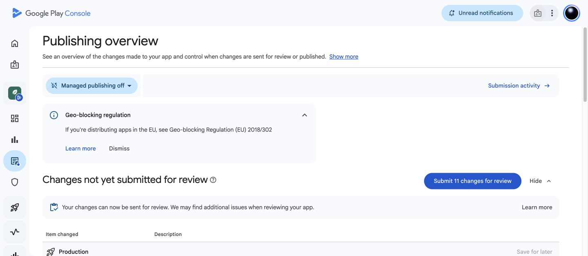
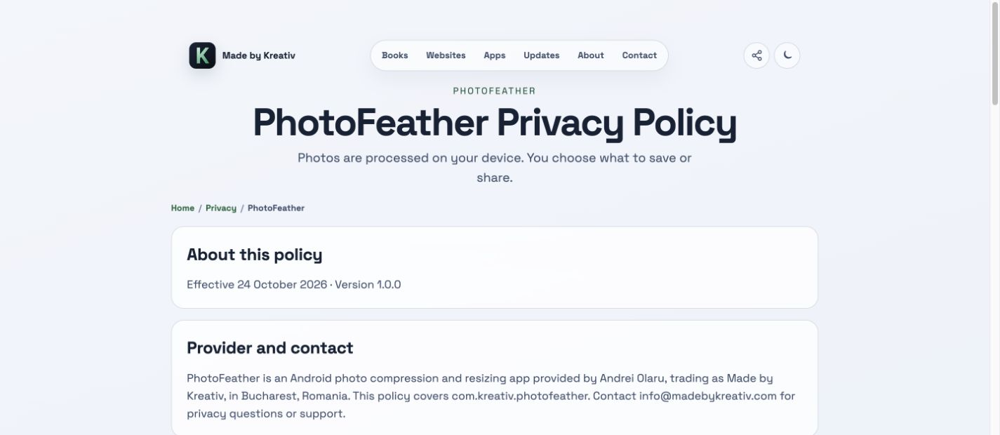

# PhotoFeather — production review preparation

24 October 2026 · `com.kreativ.photofeather` · version 1.0.0 · build 4.

**Preparation complete. The app has not been submitted for production review or published.** Google Play's quick checks finished and Publishing overview states: “Your changes can now be sent for review.” It shows 11 changes under “Changes not yet submitted for review.” This is preparation, not Google approval.

## Saved in Google Play

- Production candidate: **1.0.0 (4) — Production candidate**, reusing the accepted signed bundle from the artifact library. No app rebuild or new bundle upload was needed.
- Availability: all available countries/regions, comprising 177 named entries plus Rest of world (178 selection entries). The dashboard counts 177 named countries/regions.
- Listing: en-US title, short/full descriptions, icon, feature graphic and six genuine app screenshots. Photography category, support email and website saved. Play's required AI-asset declaration labels the AI-assisted icon and feature graphic; the running-app screenshots are not labelled as generated.
- Public privacy URL: **https://madebykreativ.com/privacy/photofeather/**, verified live before saving it.
- Data safety: no reportable collection or sharing by PhotoFeather. On-device processing and explicit secondary-app sharing are explained in the policy.
- App access: all features available without special access. No ads, Advertising ID, government, financial or health features.
- Target audience: 13–15, 16–17 and 18+, as explicitly selected by the owner.
- IARC: completed after the owner explicitly accepted its terms. Ratings include ESRB Everyone, PEGI 3, Brazil All ages, USK All ages and generic IARC 3+. Questionnaire completion is separate from submitting the app for review.
- App content overview: no declarations needing attention.

Production preview reported **zero errors and one warning**: no deobfuscation file. This build has `minifyEnabled false`, so there is no mapping file to supply. Subsequent automatic quick checks completed and permit review submission.

The dashboard says **Not yet sent for review**. No Submit/Send for review, Publish or Save and publish action was taken. Internal testing was not activated, tester lists were not changed and no invitations were sent. Closed/open tests were not created. Managed publishing is currently **off**; a future review submission must account for the resulting launch behaviour and requires the owner's new instruction.

## Privacy website publication

Published the policy on the existing Made by Kreativ website, using its established Astro layout. Added it to the privacy directory, sitemap and site validation routes. Corrected a continuation paragraph initially rendered as a heading, then verified the final live page in Chrome and over HTTPS (HTTP 200). The support email is visible and its mailto link works in the rendered page. The policy covers local working-file retention, original preservation, sharing, source-metadata removal and its limits; it does not claim anonymisation.

Website repository: `aolaru/madebykreativ.com`. Authorised publication committed and pushed:

- `4abdbc454ea7f492bb3ddf978c139426b25d25bc` — Publish PhotoFeather privacy policy.
- `57bf767f11732f6ec2fa5af20670164a77783088` — Keep PhotoFeather policy continuation text in paragraphs.

[Final build/deployment](https://github.com/aolaru/madebykreativ.com/actions/runs/40110850365) completed successfully. The app already contains the full offline policy in About, so no app rebuild was needed. Google's [User Data policy](https://support.google.com/googleplay/android-developer/answer/10144311?hl=en) permits a privacy-policy link or text inside the app.

## Validation

- Final website `npm run check`: **135 passed, 2 skipped**; HTML, internal links, release artifacts and redirect checks passed. See `website-check.log`.
- Additional Firefox/WebKit checks: **12 passed** before the paragraph-only formatting correction. See `website-cross-browser.log`; the final deployment's CI also succeeded.
- Live verification and unchanged signed-artifact SHA-256 values: `privacy-public-verification.json`.
- No Android source changes this pass, so Android suites were not rerun. Previous signed-release preparation records **95 automated checks passed** (26 JVM, 19 engine, 47 app and 3 release checks). See the [signed-build report](../play-1.0.0/REPORT.md) and [resize validation](../resize-presets/REPORT.md).
- Original signed build 4 AAB/APK checksums still match the archived release; no signing keys were changed.

Remaining validation limits: human TalkBack speech/swipe review, broader physical-device/provider coverage and installation/testing through Google Play have not been completed. No claim of these checks or Google review approval is made. A later app change must repeat the relevant tests and update declarations if behaviour changes.

## Evidence

Screenshots are genuine captures of the live website and Play Console. The earlier IARC terms screenshot records the confirmation boundary before the owner accepted it; it is historical, not an outstanding task.

Additional captures: `app-content-complete.png`, `content-ratings-completed.png`, `production-validation.png` and `dashboard-not-sent-for-review.png`.
