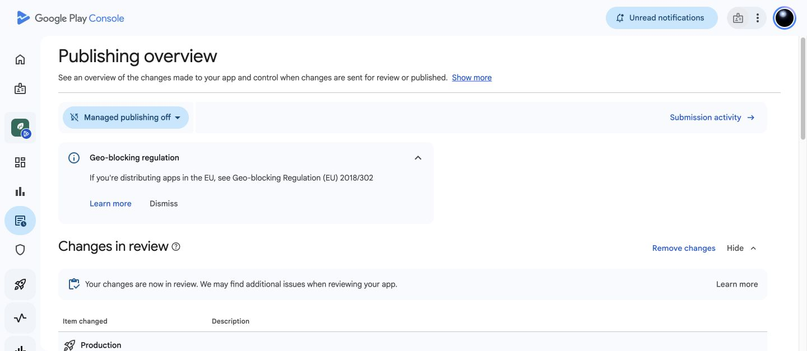

# PhotoFeather — production review submission

24 October 2026 · `com.kreativ.photofeather` · version 1.0.0 · build 4.

The owner explicitly instructed: “Submit PhotoFeather 1.0.0 (build 4) for production review and let it publish once Google approves it.” This supersedes the previous preparation-only restriction.

## Completed

- Verified the pending production candidate **1.0.0 (4) — Production candidate**, full rollout, all available countries/regions, listing and declarations in Publishing overview.
- Confirmed managed publishing **off**, allowing publication after Google approves the submission.
- Clicked **Submit 11 changes for review**, then **Send changes for review** in Google's confirmation dialog.
- Verified that Publishing overview moved the production release and associated changes into **Changes in review**.
- Retained the existing signed build 4. No app source, signing key, bundle or tester configuration was changed. Internal testing remains inactive.

The submission was accepted by Play Console. Its automatic quick checks completed, and a page reload confirmed **“Your changes are now in review.”** This is not Google approval or confirmation that the app is live.

Google's confirmation dialog said reviews are typically completed within seven days but may take longer. No approval time or publication date is promised. Publication is authorised after approval; no scheduled monitoring or notification task was created.

The [preparation report](../production-preparation/REPORT.md) retains the pre-submission state, completed declarations, website deployment/tests and remaining manual QA limits. That historical report's unsubmitted status has been superseded by this submission.

## Evidence

[Publishing overview](https://play.google.com/console/u/0/developers/7594712361231234431/app/4975471320992261227/publishing)

