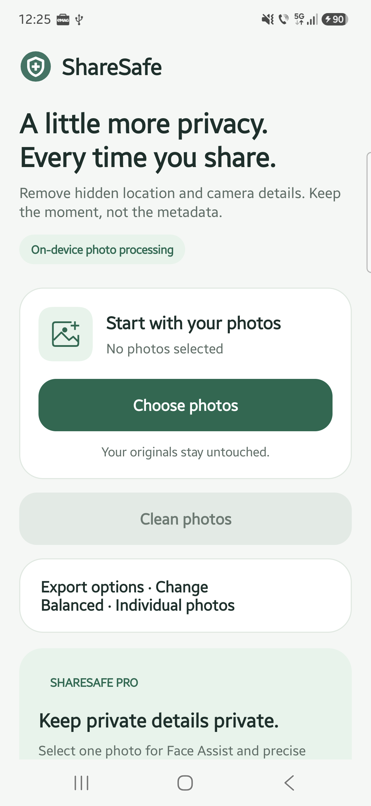
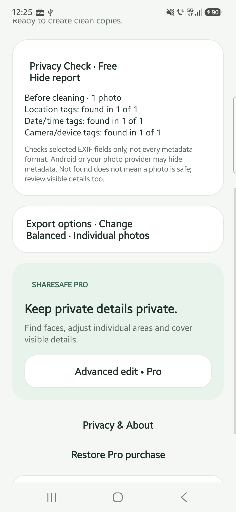
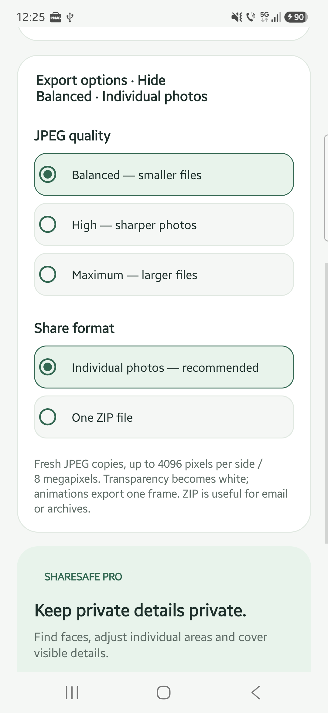
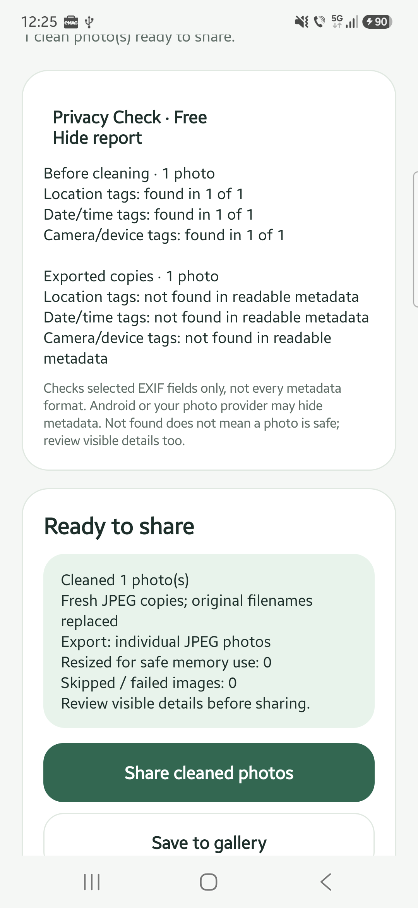
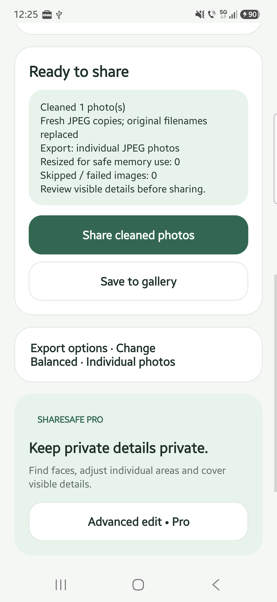

To remove embedded photo metadata with ShareSafe, choose your photos, inspect the free **Privacy Check**, then tap **Clean photos**. Save or share the new JPEG copies instead of the originals. Photo processing happens on your Android device, and your original files stay unchanged.

This guide covers the Google Play edition. Metadata cleaning and Privacy Check are free; the optional Pro editing tools are not needed for the main steps below.

Screenshots show the 1.2.0 test build on a Samsung Galaxy A55, using a demo image with synthetic metadata. Tap any screenshot to view it at full size.

[Get ShareSafe on Google Play](https://play.google.com/store/apps/details?id=com.kreativ.sharesafe&utm_source=madebykreativ&utm_medium=website&utm_campaign=sharesafe_privacy_202610&utm_content=metadata_tutorial_intro)

## What photo metadata can reveal

A photo file can contain information beyond the visible picture. EXIF metadata may include GPS location, the original capture date and time, and camera or device details. The fields present depend on the image, camera settings and how the file has been handled.

Removing embedded metadata addresses that information, not everything someone could learn from the picture. A street sign, face, document or reflection may still reveal something private.

For example, if you are sending a photo of an item you want to sell, clean a copy and also check the background for your house number, mail or personal documents. Metadata removal is not an anonymity guarantee.

## Clean a photo copy step by step

### 1 Choose the photos

Open ShareSafe and tap **Choose photos**. Use Android’s system picker to select one or more images. ShareSafe does not request broad access to your entire gallery.

For a first try, use a non-sensitive photo. If you choose a file from a cloud provider, that provider may need to download it before ShareSafe can process it.

*Start with Choose photos. The screenshots do not show a private gallery.*

### 2 Inspect Privacy Check

Expand **Privacy Check · Free** to see the original metadata report. It checks whether selected readable EXIF fields contain location, date/time or camera/device information. It reports their presence, not the actual coordinates or identifying values.

Read the results carefully:

| Result | What it means |
| --- | --- |
| Found | At least one checked field in that category was readable and present. |
| Not found in readable metadata | None of the checked fields in that category was found in the data available to the app. |
| Unknown or unreadable | The app could not complete that part of the check. |

The check does not cover every metadata format. Android or your selected photo provider may hide source metadata, so “not found” is not a clean bill of health.

*The demo file contains all three checked categories. Only their presence is shown, not the underlying values.*

### 3 Choose how to export

Open **Export options** and choose a JPEG quality setting. **Balanced** produces smaller files; **High** and **Maximum** use higher JPEG quality settings. All three create new JPEG copies rather than identical backups.

Choose **Individual photos** for separate images, or **One ZIP file** to package the copies together for email or an archive. The ZIP contains JPEG copies, not the original files.

*Balanced quality and Individual photos are selected here. Change them before cleaning if needed.*

### 4 Create the copies

Tap **Clean photos** and wait for processing to finish. ShareSafe redraws the images into fresh JPEG files without carrying over the original embedded metadata or filenames.

Large images may be resized: exported copies are limited to 4096 pixels per side and 8 megapixels. Transparent areas become white, and animated images export a single frame. Your originals are not modified.

### 5 Check the result

Expand Privacy Check again to see the before/after report. ShareSafe checks the exported JPEGs for the same selected EXIF fields. Copies that still contain checked fields, or cannot be verified, are skipped rather than offered for sharing.

If an image is skipped, read the app’s status message. Do not substitute an unchecked original and assume it has been cleaned.

*Compare the original with the exported copy. The same check limitations still apply.*

### 6 Review and share the new copy

Tap **Save to gallery**, then open the new image in your gallery to check its visible contents. Saved copies normally appear in **Pictures/ShareSafe**. Make sure you are reviewing the exported copy, not the original.

When ready, return to ShareSafe and use **Share cleaned photos** or **Share ZIP**, depending on your export choice. Android opens its sharing options so you can choose a destination. The receiving app handles the file under its own privacy policy and may upload it when you send or post it.

*Use the new copy from the result card. Cleaning does not send or publish the photo.*

## Hide visible details with optional Pro editing

If the picture contains a face, name, address or other visible information you want to conceal, metadata cleaning alone will not hide it.

The Google Play edition offers **Advanced edit · Pro** as a one-time paid unlock. Select one photo, open the editor and use **Cover** to place solid masks over sensitive areas. You can adjust individual areas and use undo/redo. Blur and pixelation are optional effects, but retain visual information; prefer solid Cover for sensitive details.

**Face Assist** suggests possible face areas on-device. Numbered outlines are suggestions, not redactions: review them and apply selected covers or dismiss them. Detection can miss faces and does not automatically find text, IDs or number plates.

Tap **Create redacted copy** when your edits are ready. Back on the main screen, tap **Clean photos** to prepare that copy for sharing, then review the exported image.

## Does ShareSafe upload photos

Photo cleaning, metadata checks, editing and face detection happen on-device. ShareSafe does not upload your photos or face-detection results to Made by Kreativ or Google.

That is different from saying no data is collected. The Play edition includes Google ML Kit, which collects diagnostic and usage information, including device/app information and per-installation identifiers. Google Play handles optional purchases. See the [ShareSafe privacy policy](https://madebykreativ.com/privacy/sharesafe/) and [Google’s ML Kit data disclosure](https://developers.google.com/ml-kit/android-data-disclosure).

## Before you share

- Confirm that you are sending the exported copy, not the original.
- Read the selected metadata check without treating it as a guarantee.
- Review faces, text, reflections and the background for visible private details.
- Check the destination and audience before you send or publish.

Keep originals as your source files. Use a reviewed copy for the share you intend to make.

[Try ShareSafe on Google Play](https://play.google.com/store/apps/details?id=com.kreativ.sharesafe&utm_source=madebykreativ&utm_medium=website&utm_campaign=sharesafe_privacy_202610&utm_content=metadata_tutorial_footer) · [ShareSafe features](https://madebykreativ.com/apps/sharesafe/) · [Get support](https://madebykreativ.com/contact/)
